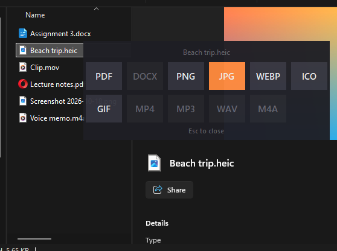
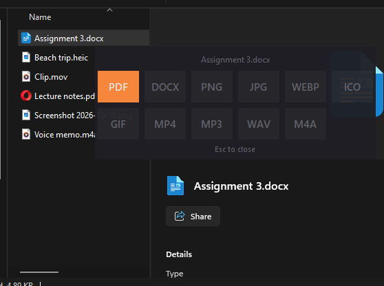
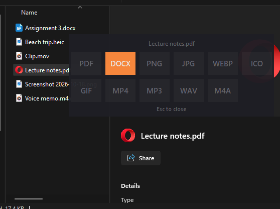
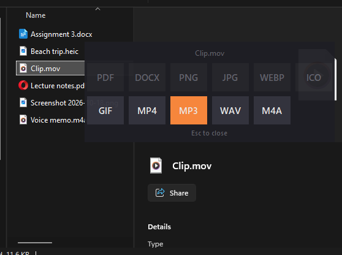
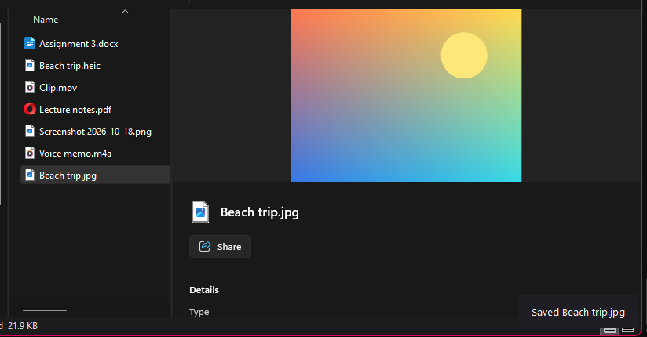

# ShiftDrop

A tiny file converter for Windows that lives in File Explorer.
**Select a file, press `Q`, click a format.** The converted copy appears right
next to the original.



- Works on files in any Explorer window and on the desktop
- Select several files at once to convert them all in one go
- Your original files are never changed, moved or overwritten
  (`photo.jpg` already there? You get `photo (1).jpg`)
- Free: no Microsoft Office or other paid software needed

## What it converts

| From | To |
|---|---|
| DOC, DOCX, RTF, ODT (Word documents) | PDF, DOCX |
| PDF | DOCX (editable Word document) |
| PNG, JPG, WEBP, BMP, GIF, TIFF, ICO, HEIC (iPhone photos) | PNG, JPG, WEBP, ICO, PDF, GIF |
| MP4, MOV, MKV, AVI, WEBM, ... | MP4, GIF, MP3, WAV, M4A |
| MP3, WAV, M4A, OGG, FLAC, ... | MP3, WAV, M4A |

Formats that don't fit the files you selected are greyed out.

## How it works

**1. Select a file and press `Q`.** A format picker pops up at your mouse.

| Word document → PDF | PDF → Word document | Video → audio |
|---|---|---|
|  |  |  |

**2. Click a format.** A message in the bottom-right corner tells you when it's
done, and the new file is in the same folder.



To close the picker without converting, press `Esc`, press `Q` again, or click
anywhere else.

`Q` only opens the picker while you're in Explorer's file list or on the
desktop. Everywhere else - other apps, Explorer's address bar or search box,
renaming a file - `Q` types a normal Q.

## Get it running on your laptop

You need **Windows 10 or 11**. Setup takes about 5 minutes.

### 1. Install Python (once)

1. Go to [python.org/downloads](https://www.python.org/downloads/) and click
   the big **Download Python** button.
2. Run the installer and **tick "Add python.exe to PATH"** at the bottom of
   the first screen, then click **Install Now**.

### 2. Download ShiftDrop

1. On this page, click the green **Code** button, then **Download ZIP**.
2. Right-click the downloaded ZIP, choose **Properties**, tick **Unblock**
   (if you see it) and click **OK**. This stops Windows from warning about
   every file inside.
3. Right-click the ZIP again and choose **Extract All...**. Put the folder
   somewhere it can stay, for example `Documents\ShiftDrop`.

Or, if you use git:

```
git clone https://github.com/fatzzi/shiftdrop.git
```

### 3. Run the installer

Open the folder and double-click **`install.bat`**. It will:

1. Set up ShiftDrop's own Python environment (in a `.venv` folder) and
   install what it needs. Takes a minute or two.
2. Ask to install **ffmpeg** (free) - say **Y** if you want to convert videos
   and audio.
3. Ask to install **LibreOffice** (free, about 350 MB) - say **Y** if you want
   to turn Word documents into PDFs. PDF to Word works without it.
4. Ask whether ShiftDrop should **start with Windows** - say **Y** so it's
   always ready.
5. Start ShiftDrop.

If Windows shows **"Windows protected your PC"**, click **More info → Run
anyway**. It appears because the file came from the internet.

### 4. Try it

Open File Explorer, click any photo or document, and press **`Q`**.

ShiftDrop has no window or taskbar icon: it waits quietly in the background
until you press `Q`.

## Everyday use

| File | What it does |
|---|---|
| `start.bat` | start ShiftDrop (if it isn't set to start with Windows) |
| `stop.bat` | stop it |
| `uninstall.bat` | stop it and remove it from Windows startup |
| `install.bat` | run again after moving the folder, or to add ffmpeg / LibreOffice later |

To remove ShiftDrop completely, run `uninstall.bat` and then delete the folder.

## Good to know

- **PDF → DOCX** rebuilds the document from the PDF's pages using
  [pdf2docx](https://github.com/ArtifexSoftware/pdf2docx). Text, tables and
  images come through as editable content, but always open the result and
  check the layout before submitting it anywhere. A scanned PDF (pages that are
  just photos) becomes a Word file of images, because there's no text in it.
- **DOC/DOCX → PDF** uses [LibreOffice](https://www.libreoffice.org/) running
  hidden in the background. Each document takes a few seconds; the very first
  one after installing LibreOffice can take about 30 seconds.
- **Video and audio** use [ffmpeg](https://ffmpeg.org/).
- **Want a different key than `Q`?** Change `HOTKEY_VK` near the top of
  `shiftdrop.py` (for example `0x43` for C), then run `stop.bat` and
  `start.bat`.
- If something goes wrong, details are written to `shiftdrop.log` in the
  ShiftDrop folder.

## Files

- `shiftdrop.py` - the whole app (Q hotkey, format picker, converters)
- `requirements.txt` - Python packages: Pillow, pillow-heif, comtypes, pdf2docx
- `install.bat`, `start.bat`, `stop.bat`, `uninstall.bat` - the helpers above
- `docs/` - the screenshots in this README

## License

ShiftDrop is released under the [MIT License](LICENSE): use it, change it and
share it freely. The tools it installs and runs (Pillow, pillow-heif, comtypes,
pdf2docx and its PyMuPDF dependency, ffmpeg, LibreOffice) are separate
projects under their own licences.
